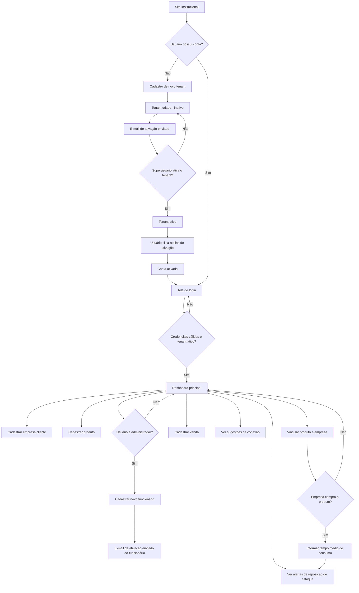
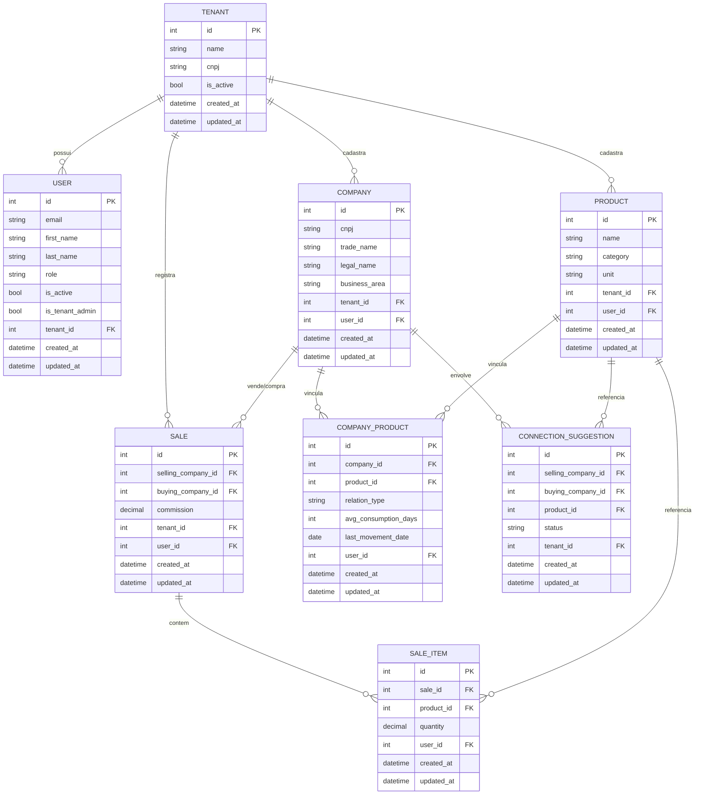

# PRD — SaaS Vendedor

## 1. Visão geral

O **SaaS Vendedor** é uma plataforma multitenant desenvolvida para vendedores que atendem múltiplas empresas clientes, permitindo o gerenciamento centralizado de relacionamentos comerciais, produtos, vendas e comissões. Cada empresa (tenant) que utiliza o sistema possui seus próprios usuários, dados e permissões, garantindo total isolamento entre os clientes da plataforma.

O produto é construído como uma aplicação full stack em Django, unindo backend e frontend em um único projeto, utilizando Class Based Views, Django Template Language e TailwindCSS com identidade visual inspirada no shadcn/ui.

## 2. Sobre o produto

O sistema permite que um vendedor (ou equipe de vendas de uma empresa) cadastre e gerencie as empresas que atende, os produtos que essas empresas compram ou vendem, e as vendas realizadas entre elas. O diferencial do produto está em:

- Monitorar o consumo médio de estoque dos produtos comprados pelas empresas clientes, alertando o vendedor no momento ideal de reabastecimento.
- Sugerir conexões comerciais entre empresas cadastradas, identificando oportunidades de venda com base nos produtos que cada uma compra ou vende.
- Estruturar o controle de comissões sobre vendas intermediadas.

## 3. Propósito

Resolver a dificuldade de vendedores e equipes comerciais em administrar, de forma organizada e proativa, uma carteira de empresas clientes, evitando perda de vendas por falta de acompanhamento do ciclo de consumo de produtos e por falta de visibilidade sobre oportunidades de conexão entre empresas.

## 4. Público-alvo

- Vendedores autônomos ou representantes comerciais que atendem múltiplas empresas.
- Pequenas e médias empresas com equipes comerciais que precisam gerenciar carteira de clientes B2B.
- Empresas distribuidoras que compram e vendem produtos entre si e precisam de intermediação comercial.

## 5. Objetivos

- Permitir o cadastro multitenant de empresas usuárias do sistema (tenants) com ativação controlada.
- Permitir que cada tenant gerencie seus próprios usuários, funções e permissões.
- Permitir o cadastro de empresas clientes/atendidas, com CNPJ, dados cadastrais e área de atuação.
- Permitir o cadastro de produtos, vinculando-os às empresas como produtos comprados ou vendidos.
- Alertar o vendedor sobre o momento ideal de recontato com uma empresa cliente, com base no tempo médio de consumo de estoque.
- Sugerir conexões comerciais entre empresas cadastradas.
- Registrar vendas realizadas, com empresa compradora, vendedora, produtos e comissão.
- Entregar uma interface moderna, responsiva e consistente, com identidade visual própria.

## 6. Requisitos funcionais

### 6.1 Autenticação e gestão de acesso

- RF01 — O login deve ser realizado por e-mail e senha, utilizando o sistema nativo de autenticação do Django adaptado para autenticação por e-mail.
- RF02 — O cadastro de um novo tenant (empresa que deseja usar o sistema) deve criar automaticamente um usuário administrador vinculado a esse tenant.
- RF03 — Todo tenant recém-cadastrado deve nascer inativo, exigindo ativação manual pelo superusuário/dono do sistema antes que qualquer usuário do tenant possa logar.
- RF04 — Ao se cadastrar, o usuário administrador do tenant deve receber um e-mail com link de ativação de conta.
- RF05 — O administrador do tenant pode cadastrar novos usuários (funcionários), definindo função e permissões específicas.
- RF06 — Ao cadastrar um novo funcionário, um e-mail com link de ativação de conta deve ser enviado a ele.
- RF07 — O administrador do tenant tem acesso a todas as funcionalidades e dados do próprio tenant.
- RF08 — Usuários sem permissão de administrador só acessam as funcionalidades liberadas explicitamente pelo administrador.

### 6.2 Empresas (clientes atendidos)

- RF09 — O usuário pode cadastrar novas empresas clientes, informando obrigatoriamente CNPJ, nome fantasia e razão social.
- RF10 — O CNPJ não pode se repetir dentro do mesmo tenant (unicidade por tenant).
- RF11 — A empresa cadastrada deve possuir um campo de área de atuação.
- RF12 — É possível vincular produtos a uma empresa, especificando se ela compra ou vende aquele produto.

### 6.3 Produtos

- RF13 — O usuário pode cadastrar produtos, informando categoria e unidade de medida.
- RF14 — Ao vincular um produto que uma empresa compra, o usuário deve informar o tempo médio de consumo do estoque daquele produto por aquela empresa.
- RF15 — O sistema deve calcular, com base na última venda registrada e no tempo médio de consumo, a data estimada em que a empresa ficará sem estoque.
- RF16 — O sistema deve alertar o vendedor quando uma empresa estiver próxima de esgotar o estoque de um produto, sinalizando a necessidade de contato para nova venda.

### 6.4 Sugestão de conexões comerciais

- RF17 — O sistema deve identificar empresas que vendem um produto que outra empresa compra, sugerindo essa conexão ao usuário.
- RF18 — As sugestões de conexão devem ser exibidas em uma área específica do sistema, com as empresas envolvidas e o produto em comum.

### 6.5 Vendas

- RF19 — Usuários com permissão podem cadastrar vendas, informando empresa compradora, empresa vendedora, produtos vendidos (com quantidade) e comissão a receber.
- RF20 — O cadastro de uma venda deve atualizar a referência de última movimentação do produto para fins de cálculo de previsão de reposição de estoque.

### 6.6 Site institucional e dashboard

- RF21 — O sistema deve possuir um site público de apresentação, com opções de "Cadastre-se" e "Login".
- RF22 — Após o login, o usuário deve ser redirecionado ao dashboard principal do sistema, com visão geral de alertas, sugestões e indicadores.

### 6.7 Fluxograma de UX (Mermaid)

## 7. Requisitos não-funcionais

- RNF01 — O sistema deve ser multitenant, com isolamento lógico de dados por tenant.
- RNF02 — O sistema deve utilizar banco de dados SQLite (padrão do Django) em todos os ambientes inicialmente.
- RNF03 — Todas as tabelas/models devem conter os campos `created_at`, `updated_at` e `user`.
- RNF04 — O código-fonte deve ser escrito em inglês (nomes de variáveis, classes, funções, comentários).
- RNF05 — Toda informação exibida na interface deve estar em português brasileiro.
- RNF06 — O código deve seguir os padrões da PEP8 e utilizar aspas simples sempre que possível.
- RNF07 — As entidades do sistema devem ser separadas em apps Django distintos, isolando responsabilidades.
- RNF08 — Sempre que possível, devem ser utilizadas Class Based Views e recursos nativos do Django.
- RNF09 — Signals, quando utilizados, devem ficar em um arquivo `signals.py` dentro da app correspondente.
- RNF10 — Todas as funções, views e models devem possuir testes automatizados com pytest.
- RNF11 — O sistema deve ser responsivo, funcionando adequadamente em desktop, tablet e mobile.
- RNF12 — Não deve haver containerização (Docker) nas fases iniciais do projeto; isso deve ser implementado apenas nas sprints finais.
- RNF13 — O sistema deve manter identidade visual única e consistente entre todas as telas.

## 8. Arquitetura técnica

### 8.1 Stack

| Camada | Tecnologia |
|---|---|
| Backend | Django 5+ (Class Based Views) |
| Frontend | Django Template Language + TailwindCSS |
| Estilo visual | Inspirado em shadcn/ui |
| Banco de dados | SQLite (padrão Django) |
| Autenticação | Sistema nativo do Django, adaptado para login por e-mail |
| Testes | pytest / pytest-django |
| Envio de e-mail | Django email backend (console em dev, SMTP em produção) |
| Containerização | Não implementada nas fases iniciais (prevista para sprints finais) |

### 8.2 Apps Django sugeridas

- `core` — configurações e templates base, componentes de UI compartilhados.
- `tenants` — modelo de Tenant e regras de ativação/isolamento.
- `accounts` — modelo de usuário customizado (login por e-mail), ativação de conta, permissões.
- `companies` — cadastro de empresas clientes.
- `products` — cadastro de produtos e vínculo empresa-produto.
- `sales` — registro de vendas e comissões.
- `suggestions` — lógica de sugestão de conexões comerciais.
- `dashboard` — página inicial pós-login com indicadores e alertas.
- `landing` — site institucional público.

### 8.3 Estrutura de dados (Mermaid ER)

## 9. Design system

### 9.1 Diretrizes gerais

Identidade visual moderna, limpa e minimalista, inspirada no shadcn/ui, implementada inteiramente com TailwindCSS dentro do Django Template Language (sem uso de frameworks JS pesados). Uso consistente de componentes reutilizáveis (partials/includes do Django) para garantir padronização entre todas as telas.

### 9.2 Cores

| Uso | Token | Exemplo (Tailwind) |
|---|---|---|
| Primária | `primary` | `bg-zinc-900` / `text-zinc-50` |
| Primária hover | `primary-hover` | `hover:bg-zinc-800` |
| Fundo principal | `background` | `bg-white` / `dark:bg-zinc-950` |
| Fundo secundário (cards) | `surface` | `bg-zinc-50` / `dark:bg-zinc-900` |
| Borda | `border` | `border-zinc-200` / `dark:border-zinc-800` |
| Texto principal | `foreground` | `text-zinc-900` / `dark:text-zinc-50` |
| Texto secundário | `muted-foreground` | `text-zinc-500` |
| Sucesso | `success` | `bg-emerald-600` |
| Alerta | `warning` | `bg-amber-500` |
| Erro/Destrutivo | `destructive` | `bg-red-600` |

### 9.3 Tipografia

- Fonte base: `font-sans` (Inter ou similar, carregada via Google Fonts ou self-hosted).
- Títulos de página: `text-2xl font-semibold tracking-tight`.
- Subtítulos: `text-lg font-medium`.
- Texto padrão: `text-sm text-zinc-700`.
- Texto auxiliar/legendas: `text-xs text-muted-foreground`.

### 9.4 Botões

- Botão primário: `rounded-md bg-zinc-900 text-white px-4 py-2 text-sm font-medium hover:bg-zinc-800 transition-colors`.
- Botão secundário: `rounded-md border border-zinc-200 bg-white px-4 py-2 text-sm font-medium hover:bg-zinc-50`.
- Botão destrutivo: `rounded-md bg-red-600 text-white px-4 py-2 text-sm font-medium hover:bg-red-700`.
- Botão desabilitado: `opacity-50 pointer-events-none`.

### 9.5 Inputs e formulários

- Input padrão: `rounded-md border border-zinc-200 px-3 py-2 text-sm focus:outline-none focus:ring-2 focus:ring-zinc-900`.
- Label: `text-sm font-medium text-zinc-700 mb-1`.
- Mensagem de erro: `text-xs text-red-600 mt-1`.
- Formulários organizados em `grid grid-cols-1 md:grid-cols-2 gap-4` dentro de um card `rounded-lg border border-zinc-200 bg-white p-6 shadow-sm`.

### 9.6 Cards e grids

- Card padrão: `rounded-lg border border-zinc-200 bg-white p-6 shadow-sm`.
- Grid de listagem: `grid grid-cols-1 sm:grid-cols-2 lg:grid-cols-3 gap-4`.
- Tabelas: cabeçalho `bg-zinc-50 text-xs uppercase text-zinc-500`, linhas `divide-y divide-zinc-100 hover:bg-zinc-50`.

### 9.7 Menus e navegação

- Menu lateral (sidebar) fixo em telas autenticadas: `w-64 border-r border-zinc-200 bg-white`, itens ativos com `bg-zinc-100 text-zinc-900 font-medium`.
- Topbar com nome do tenant, usuário logado e ações rápidas.
- Menu responsivo: sidebar colapsa em menu hambúrguer em telas `sm`.

### 9.8 Componentes reutilizáveis (templates)

- `_button.html`, `_input.html`, `_card.html`, `_table.html`, `_alert.html`, `_badge.html`, `_modal.html`, `_sidebar.html`, `_topbar.html`.

## 10. User stories

### Épico 1 — Autenticação e multitenancy

- **US01**: Como visitante, quero me cadastrar informando os dados da minha empresa, para começar a usar o sistema.
  - Critérios de aceite:
    - Dado que preencho o formulário de cadastro com dados válidos, um novo tenant é criado como inativo.
    - Um e-mail de ativação é enviado ao administrador cadastrado.
    - Não é possível logar antes da ativação do tenant pelo superusuário.
- **US02**: Como superusuário do sistema, quero ativar tenants recém-cadastrados, para liberar o acesso ao sistema.
  - Critérios de aceite:
    - Consigo visualizar a lista de tenants pendentes de ativação.
    - Ao ativar um tenant, os usuários vinculados podem logar (após confirmarem o e-mail).
- **US03**: Como usuário, quero logar utilizando meu e-mail e senha, para acessar o sistema.
  - Critérios de aceite:
    - O campo de login exige e-mail, não username.
    - Login é recusado se o tenant estiver inativo ou a conta não estiver ativada.
- **US04**: Como administrador de tenant, quero cadastrar novos funcionários definindo função e permissões, para que eles possam usar o sistema.
  - Critérios de aceite:
    - Consigo selecionar quais permissões o novo usuário terá.
    - Um e-mail de ativação é enviado ao novo funcionário.

### Épico 2 — Empresas clientes

- **US05**: Como usuário, quero cadastrar uma empresa cliente informando CNPJ, nome fantasia e razão social, para começar a gerenciar o relacionamento comercial com ela.
  - Critérios de aceite:
    - O sistema impede o cadastro de CNPJ duplicado dentro do mesmo tenant.
    - Área de atuação é campo obrigatório.
- **US06**: Como usuário, quero vincular produtos a uma empresa, informando se ela compra ou vende, para mapear o relacionamento comercial.
  - Critérios de aceite:
    - Ao marcar que a empresa compra o produto, o campo de tempo médio de consumo é exibido e obrigatório.

### Épico 3 — Produtos e alertas de reposição

- **US07**: Como usuário, quero cadastrar produtos com categoria e unidade, para organizá-los no sistema.
  - Critérios de aceite:
    - Categoria e unidade são campos obrigatórios no cadastro de produto.
- **US08**: Como usuário, quero ser alertado quando uma empresa estiver perto de ficar sem estoque de um produto, para entrar em contato e vender novamente.
  - Critérios de aceite:
    - O sistema calcula a data estimada de esgotamento com base na última venda e no tempo médio de consumo.
    - Um alerta é exibido no dashboard quando a data estimada estiver próxima.

### Épico 4 — Sugestões de conexão

- **US09**: Como usuário, quero ver sugestões de conexão entre empresas que vendem e compram o mesmo produto, para identificar oportunidades de venda.
  - Critérios de aceite:
    - As sugestões exibem empresa vendedora, empresa compradora e produto em comum.
    - Sugestões já efetivadas em venda não continuam sendo exibidas como pendentes.

### Épico 5 — Vendas e comissões

- **US10**: Como usuário com permissão, quero registrar uma venda informando empresa compradora, vendedora, produtos e comissão, para controlar minhas comissões a receber.
  - Critérios de aceite:
    - O sistema exige ao menos um produto vinculado à venda.
    - O valor da comissão é armazenado e exibido no histórico de vendas.

### Épico 6 — Site institucional e dashboard

- **US11**: Como visitante, quero acessar um site institucional com opções de cadastro e login, para conhecer e acessar o sistema.
  - Critérios de aceite:
    - A página inicial pública exibe claramente os botões "Cadastre-se" e "Login".
- **US12**: Como usuário logado, quero ver um dashboard com alertas e sugestões relevantes, para agir rapidamente.
  - Critérios de aceite:
    - O dashboard exibe alertas de reposição de estoque e sugestões de conexão pendentes.

## 11. Métricas de sucesso

### 11.1 KPIs de produto

- Número de tenants ativos no sistema.
- Tempo médio entre cadastro e ativação de um novo tenant.
- Número de vendas registradas por mês.
- Número de sugestões de conexão convertidas em vendas efetivas.

### 11.2 KPIs de usuário

- Número de usuários ativos por tenant (DAU/MAU).
- Percentual de alertas de reposição de estoque que resultam em contato/venda.
- Tempo médio de resposta a um alerta de reposição de estoque.

### 11.3 KPIs técnicos

- Cobertura de testes automatizados (meta mínima: 80% em models e views).
- Tempo médio de resposta das páginas principais.
- Taxa de erros/exceções em produção.

## 12. Riscos e mitigações

| Risco | Impacto | Mitigação |
|---|---|---|
| Vazamento de dados entre tenants (falha de isolamento multitenant) | Alto | Testes automatizados específicos para isolamento de dados por tenant; filtros obrigatórios por tenant em querysets. |
| Falha no envio de e-mails de ativação | Médio | Uso de backend de e-mail configurável e testável; logs de falha de envio; possibilidade de reenvio manual. |
| Baixa adoção por complexidade de cadastro de produtos/empresas | Médio | Fluxos de cadastro simples, com validações claras e mensagens de erro objetivas. |
| Cálculo impreciso do tempo de reposição de estoque | Médio | Permitir ajuste manual do tempo médio de consumo; recalcular a cada nova venda registrada. |
| Crescimento do banco SQLite comprometendo performance | Baixo (fase inicial) | Reavaliação futura de migração para outro banco quando necessário; não é escopo do MVP. |
| Escopo crescer além do solicitado (scope creep) | Médio | Seguir estritamente os requisitos definidos neste PRD, sem adicionar funcionalidades não solicitadas. |

## 13. Lista de tarefas

### Sprint 0 — Setup do projeto

- [ ] 0.1 Inicializar projeto Django
  - [ ] 0.1.1 Criar ambiente virtual e instalar Django 5+
  - [ ] 0.1.2 Criar projeto Django base (`config`)
  - [ ] 0.1.3 Configurar `settings.py` com apps separadas por domínio (estrutura inicial de pastas)
  - [ ] 0.1.4 Configurar banco de dados SQLite
- [ ] 0.2 Configurar ferramentas de qualidade de código
  - [ ] 0.2.1 Configurar `flake8`/`ruff` para PEP8 e aspas simples
  - [ ] 0.2.2 Configurar `pytest` e `pytest-django`
  - [ ] 0.2.3 Criar arquivo `conftest.py` com fixtures base (tenant, usuário)
- [ ] 0.3 Configurar TailwindCSS no projeto Django
  - [ ] 0.3.1 Instalar e configurar TailwindCSS (via django-tailwind ou build manual)
  - [ ] 0.3.2 Criar arquivo de tema com tokens de cor do design system
  - [ ] 0.3.3 Criar template base (`base.html`) com estrutura HTML e carregamento do Tailwind
- [ ] 0.4 Estrutura de apps
  - [ ] 0.4.1 Criar app `core`
  - [ ] 0.4.2 Criar app `tenants`
  - [ ] 0.4.3 Criar app `accounts`
  - [ ] 0.4.4 Criar app `companies`
  - [ ] 0.4.5 Criar app `products`
  - [ ] 0.4.6 Criar app `sales`
  - [ ] 0.4.7 Criar app `suggestions`
  - [ ] 0.4.8 Criar app `dashboard`
  - [ ] 0.4.9 Criar app `landing`

### Sprint 1 — Autenticação e multitenancy

- [ ] 1.1 Modelagem de Tenant
  - [ ] 1.1.1 Criar model `Tenant` com campos `name`, `cnpj`, `is_active`, `created_at`, `updated_at`
  - [ ] 1.1.2 Criar migração do model `Tenant`
  - [ ] 1.1.3 Escrever testes de criação e unicidade de `Tenant`
- [ ] 1.2 Modelagem de usuário customizado
  - [ ] 1.2.1 Criar `CustomUserManager` com criação de usuário por e-mail
  - [ ] 1.2.2 Criar model `User` estendendo `AbstractBaseUser`/`PermissionsMixin` com campo `tenant` (FK), `role`, `is_tenant_admin`
  - [ ] 1.2.3 Configurar `AUTH_USER_MODEL` no settings
  - [ ] 1.2.4 Escrever testes do manager e do model de usuário
- [ ] 1.3 Fluxo de cadastro de tenant
  - [ ] 1.3.1 Criar view (CBV) de cadastro de novo tenant + usuário administrador
  - [ ] 1.3.2 Criar formulário de cadastro com validações (e-mail único, senha, dados do tenant)
  - [ ] 1.3.3 Ao salvar, criar tenant inativo e usuário administrador vinculado
  - [ ] 1.3.4 Escrever testes da view de cadastro
- [ ] 1.4 Ativação de conta via e-mail
  - [ ] 1.4.1 Criar geração de token de ativação (usando `django.contrib.auth.tokens`)
  - [ ] 1.4.2 Criar `signals.py` no app `accounts` para disparo do e-mail de ativação após criação de usuário
  - [ ] 1.4.3 Criar template de e-mail de ativação
  - [ ] 1.4.4 Criar view (CBV) de confirmação de ativação via link
  - [ ] 1.4.5 Escrever testes de geração de token e confirmação de ativação
- [ ] 1.5 Ativação de tenant pelo superusuário
  - [ ] 1.5.1 Registrar `Tenant` no Django Admin com ação de ativação
  - [ ] 1.5.2 Impedir login de usuários de tenants inativos
  - [ ] 1.5.3 Escrever testes de bloqueio de login para tenant inativo
- [ ] 1.6 Autenticação por e-mail
  - [ ] 1.6.1 Criar `EmailBackend` customizado de autenticação
  - [ ] 1.6.2 Configurar `AUTHENTICATION_BACKENDS`
  - [ ] 1.6.3 Criar view (CBV) de login customizada com formulário de e-mail/senha
  - [ ] 1.6.4 Criar template de login seguindo o design system
  - [ ] 1.6.5 Escrever testes de login por e-mail
- [ ] 1.7 Gestão de usuários e permissões pelo administrador do tenant
  - [ ] 1.7.1 Criar view (CBV) de listagem de usuários do tenant
  - [ ] 1.7.2 Criar view (CBV) de cadastro de novo funcionário com seleção de função/permissões
  - [ ] 1.7.3 Restringir acesso dessas views a usuários `is_tenant_admin`
  - [ ] 1.7.4 Escrever testes de permissão e cadastro de funcionário
- [ ] 1.8 Middleware/mixin de isolamento por tenant
  - [ ] 1.8.1 Criar mixin de CBV para filtrar querysets automaticamente pelo tenant do usuário logado
  - [ ] 1.8.2 Escrever testes garantindo que um usuário não acesse dados de outro tenant

### Sprint 2 — Empresas e produtos

- [ ] 2.1 Modelagem de Company
  - [ ] 2.1.1 Criar model `Company` com `cnpj`, `trade_name`, `legal_name`, `business_area`, `tenant`, `user`, `created_at`, `updated_at`
  - [ ] 2.1.2 Adicionar constraint de unicidade de `cnpj` por `tenant`
  - [ ] 2.1.3 Escrever testes de criação e unicidade de `Company`
- [ ] 2.2 CRUD de empresas
  - [ ] 2.2.1 Criar view (CBV) de listagem de empresas do tenant
  - [ ] 2.2.2 Criar view (CBV) de criação de empresa
  - [ ] 2.2.3 Criar view (CBV) de edição de empresa
  - [ ] 2.2.4 Criar view (CBV) de exclusão de empresa
  - [ ] 2.2.5 Criar templates das telas de empresas seguindo o design system
  - [ ] 2.2.6 Escrever testes das views de CRUD de empresa
- [ ] 2.3 Modelagem de Product
  - [ ] 2.3.1 Criar model `Product` com `name`, `category`, `unit`, `tenant`, `user`, `created_at`, `updated_at`
  - [ ] 2.3.2 Escrever testes de criação de `Product`
- [ ] 2.4 CRUD de produtos
  - [ ] 2.4.1 Criar view (CBV) de listagem de produtos do tenant
  - [ ] 2.4.2 Criar view (CBV) de criação de produto
  - [ ] 2.4.3 Criar view (CBV) de edição de produto
  - [ ] 2.4.4 Criar view (CBV) de exclusão de produto
  - [ ] 2.4.5 Criar templates das telas de produtos seguindo o design system
  - [ ] 2.4.6 Escrever testes das views de CRUD de produto
- [ ] 2.5 Modelagem do vínculo empresa-produto
  - [ ] 2.5.1 Criar model `CompanyProduct` com `company`, `product`, `relation_type` (compra/venda), `avg_consumption_days`, `last_movement_date`, `user`
  - [ ] 2.5.2 Validar que `avg_consumption_days` seja obrigatório apenas quando `relation_type` for "compra"
  - [ ] 2.5.3 Escrever testes de validação do model `CompanyProduct`
- [ ] 2.6 Interface de vínculo empresa-produto
  - [ ] 2.6.1 Criar view (CBV) para vincular produto a uma empresa a partir da tela de detalhe da empresa
  - [ ] 2.6.2 Criar formulário com exibição condicional do campo de tempo médio de consumo
  - [ ] 2.6.3 Escrever testes da view de vínculo

### Sprint 3 — Alertas de reposição de estoque

- [ ] 3.1 Cálculo de previsão de esgotamento de estoque
  - [ ] 3.1.1 Criar método/utilitário para calcular data estimada de esgotamento a partir de `last_movement_date` e `avg_consumption_days`
  - [ ] 3.1.2 Escrever testes unitários do cálculo de previsão
- [ ] 3.2 Listagem de alertas
  - [ ] 3.2.1 Criar view (CBV) que lista vínculos `CompanyProduct` do tipo "compra" próximos da data estimada de esgotamento
  - [ ] 3.2.2 Definir critério de "próximo" (ex: X dias restantes) como constante configurável
  - [ ] 3.2.3 Criar template de listagem de alertas seguindo o design system
  - [ ] 3.2.4 Escrever testes da view de alertas

### Sprint 4 — Sugestões de conexão comercial

- [ ] 4.1 Modelagem de sugestão de conexão
  - [ ] 4.1.1 Criar model `ConnectionSuggestion` com `selling_company`, `buying_company`, `product`, `status`, `tenant`
  - [ ] 4.1.2 Escrever testes de criação do model
- [ ] 4.2 Lógica de geração de sugestões
  - [ ] 4.2.1 Criar função/serviço que cruza empresas que vendem um produto com empresas que compram o mesmo produto dentro do tenant
  - [ ] 4.2.2 Evitar duplicidade de sugestões já existentes com o mesmo par empresa/produto
  - [ ] 4.2.3 Escrever testes da lógica de geração de sugestões
- [ ] 4.3 Interface de sugestões
  - [ ] 4.3.1 Criar view (CBV) de listagem de sugestões de conexão pendentes
  - [ ] 4.3.2 Criar ação para marcar sugestão como "descartada" ou "convertida em venda"
  - [ ] 4.3.3 Criar template de listagem de sugestões seguindo o design system
  - [ ] 4.3.4 Escrever testes da view de sugestões

### Sprint 5 — Vendas e comissões

- [ ] 5.1 Modelagem de venda
  - [ ] 5.1.1 Criar model `Sale` com `selling_company`, `buying_company`, `commission`, `tenant`, `user`
  - [ ] 5.1.2 Criar model `SaleItem` com `sale`, `product`, `quantity`, `user`
  - [ ] 5.1.3 Escrever testes de criação dos models `Sale` e `SaleItem`
- [ ] 5.2 Cadastro de vendas
  - [ ] 5.2.1 Criar formulário de venda com formset para múltiplos produtos vendidos
  - [ ] 5.2.2 Criar view (CBV) de criação de venda, restrita a usuários com permissão específica
  - [ ] 5.2.3 Atualizar `last_movement_date` do vínculo `CompanyProduct` correspondente ao salvar a venda
  - [ ] 5.2.4 Ao registrar a venda, atualizar status de sugestão de conexão relacionada (se existir) para "convertida"
  - [ ] 5.2.5 Escrever testes da view de criação de venda
- [ ] 5.3 Listagem e histórico de vendas
  - [ ] 5.3.1 Criar view (CBV) de listagem de vendas do tenant com filtros por empresa e período
  - [ ] 5.3.2 Criar view (CBV) de detalhe de venda com produtos e comissão
  - [ ] 5.3.3 Criar templates das telas de vendas seguindo o design system
  - [ ] 5.3.4 Escrever testes das views de listagem e detalhe de venda

### Sprint 6 — Site institucional e dashboard

- [ ] 6.1 Site institucional (landing page)
  - [ ] 6.1.1 Criar template de página inicial pública com apresentação do produto
  - [ ] 6.1.2 Adicionar botões "Cadastre-se" e "Login" na landing page
  - [ ] 6.1.3 Escrever testes de renderização da landing page
- [ ] 6.2 Dashboard principal
  - [ ] 6.2.1 Criar view (CBV) de dashboard exibindo indicadores gerais (empresas, produtos, vendas do mês)
  - [ ] 6.2.2 Exibir no dashboard os alertas de reposição de estoque mais urgentes
  - [ ] 6.2.3 Exibir no dashboard as sugestões de conexão pendentes mais recentes
  - [ ] 6.2.4 Criar template do dashboard seguindo o design system
  - [ ] 6.2.5 Escrever testes da view de dashboard
- [ ] 6.3 Navegação geral autenticada
  - [ ] 6.3.1 Criar componente de sidebar reutilizável com links para todas as áreas do sistema
  - [ ] 6.3.2 Criar componente de topbar com informações do usuário/tenant logado e logout
  - [ ] 6.3.3 Garantir responsividade da navegação (colapso em mobile)

### Sprint 7 — Design system e polimento visual

- [ ] 7.1 Componentização de UI
  - [ ] 7.1.1 Criar partial `_button.html` com variações primário/secundário/destrutivo
  - [ ] 7.1.2 Criar partial `_input.html` com suporte a label e mensagem de erro
  - [ ] 7.1.3 Criar partial `_card.html`
  - [ ] 7.1.4 Criar partial `_table.html`
  - [ ] 7.1.5 Criar partial `_alert.html` (sucesso, alerta, erro)
  - [ ] 7.1.6 Criar partial `_badge.html`
  - [ ] 7.1.7 Criar partial `_modal.html`
- [ ] 7.2 Revisão de consistência visual
  - [ ] 7.2.1 Revisar todas as telas existentes para uso consistente dos componentes criados
  - [ ] 7.2.2 Validar responsividade em resoluções mobile, tablet e desktop
  - [ ] 7.2.3 Validar contraste e acessibilidade básica de cores

### Sprint 8 — Cobertura de testes e revisão final

- [ ] 8.1 Revisão de cobertura de testes
  - [ ] 8.1.1 Rodar relatório de cobertura (`pytest --cov`)
  - [ ] 8.1.2 Complementar testes faltantes em models
  - [ ] 8.1.3 Complementar testes faltantes em views
  - [ ] 8.1.4 Complementar testes faltantes em signals e utilitários
- [ ] 8.2 Revisão de código
  - [ ] 8.2.1 Rodar linter (`flake8`/`ruff`) em todo o projeto e corrigir apontamentos
  - [ ] 8.2.2 Revisar uso de aspas simples em todo o código
  - [ ] 8.2.3 Revisar nomenclatura em inglês de todo o código
- [ ] 8.3 Revisão de conteúdo em português
  - [ ] 8.3.1 Revisar todos os textos de interface para garantir português brasileiro correto
  - [ ] 8.3.2 Revisar mensagens de erro de formulários

### Sprint 9 — Docker (sprint final)

- [ ] 9.1 Containerização do projeto
  - [ ] 9.1.1 Criar `Dockerfile` para a aplicação Django
  - [ ] 9.1.2 Criar `docker-compose.yml` com serviço da aplicação
  - [ ] 9.1.3 Configurar variáveis de ambiente via `.env`
  - [ ] 9.1.4 Validar execução completa do projeto via Docker
  - [ ] 9.1.5 Documentar instruções de execução via Docker no README
